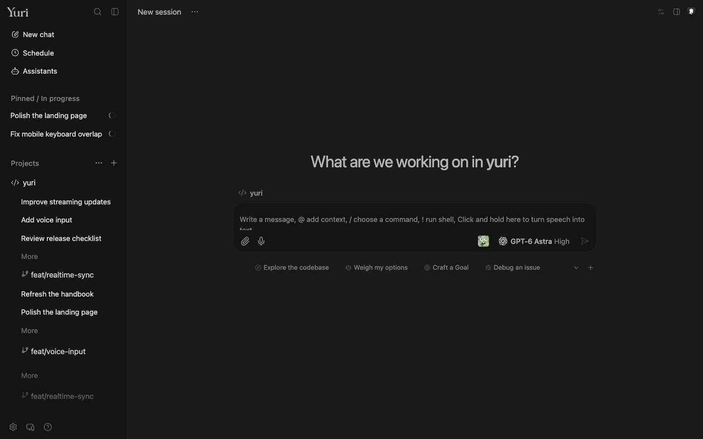
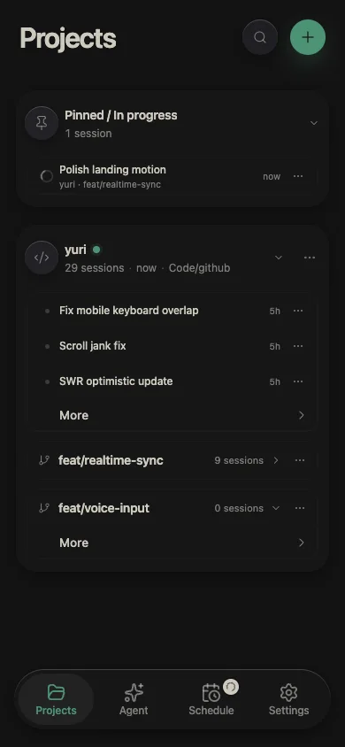
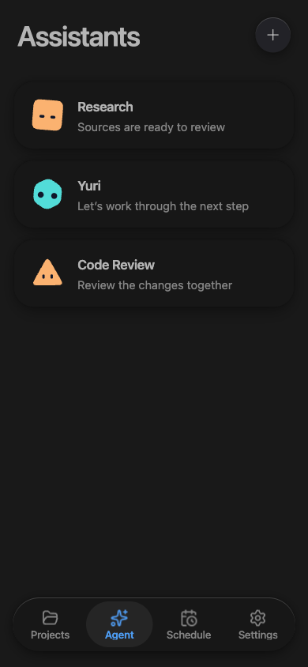
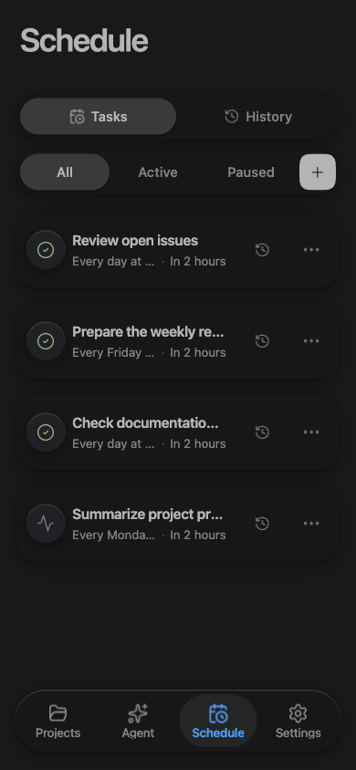

<p align="center">
  
</p>

# Yuri

**Work with AI on your computer. Pick up the conversation on your phone.**

[中文](README_ZH.md) · [Website](https://yuri.xiaobe.top/en/) · [Download](https://yuri.xiaobe.top/en/#downloads) · [Handbook](https://yuri.xiaobe.top/en/docs/)

Yuri is an OpenCode-powered workspace for coding, personal assistants and scheduled tasks. Conversations, files, terminals and previews stay together, with access from desktop, iOS, Android, browser and VS Code.



## What you can do

- **Code and review:** organize project sessions, isolate changes with worktrees, inspect diffs and commit from the Git view.
- **Delegate to an assistant:** keep an ongoing contact conversation and follow its work through session cards.
- **Automate:** use `/goal` to pursue an outcome, or schedule a prompt and check its run history.
- **Connect your devices:** pair your phone, reach a host through private Relay, or connect over SSH from the desktop app.
- **Speak and share:** dictate a follow-up, listen to replies, and share text, links or images from other mobile apps.
- **Choose your tools:** configure models, Agents, Skills, commands and MCP; use Magpie-backed models and aggregate account usage.

## Get started

1. [Install Yuri](https://yuri.xiaobe.top/en/#downloads) on the computer holding your projects.
2. Open a project, connect a provider in Settings, choose a model and start a session.
3. To continue on your phone, [pair it with that host](https://yuri.xiaobe.top/en/docs/connect-devices/).

Files and execution stay on the host. Remote access and scheduled work require it to remain online. Platform-specific controls are covered in the handbook.

<p align="center">
  
  
  
</p>

## Guides

[First session](https://yuri.xiaobe.top/en/docs/quickstart/) · [Assistants](https://yuri.xiaobe.top/en/docs/assistants/) · [Mobile](https://yuri.xiaobe.top/en/docs/mobile/) · [Voice](https://yuri.xiaobe.top/en/docs/voice/)

[Goals](https://yuri.xiaobe.top/en/docs/session-goals/) · [Schedules](https://yuri.xiaobe.top/en/docs/scheduled-tasks/) · [SSH / Relay](https://yuri.xiaobe.top/en/docs/remote-instances/) · [Magpie](https://yuri.xiaobe.top/en/docs/magpie/) · [Troubleshooting](https://yuri.xiaobe.top/en/docs/troubleshooting/)

## Development

Requires Node.js 24, Bun 1.3.14 and an installed OpenCode runtime.

```bash
git clone https://github.com/yee94/yuri.git
cd yuri
bun install
bun run dev
```

For desktop development, use `bun run electron:dev`. For VS Code, use `bun run vscode:dev`.

Shared UI lives in `packages/ui`, host services in `packages/web`, and platform integrations in `packages/electron`, `packages/mobile` and `packages/vscode`. `site/` builds the website and the handbook from `packages/docs`.

[Contributing](CONTRIBUTING.md) · [Report an issue](https://github.com/yee94/yuri/issues) · [Releases](https://github.com/yee94/yuri/releases)

## Acknowledgments

Built on the open-source foundations of [OpenChamber](https://github.com/openchamber/openchamber) and [OpenCode](https://opencode.ai).

[MIT](LICENSE). Original copyright and license notices are retained.
