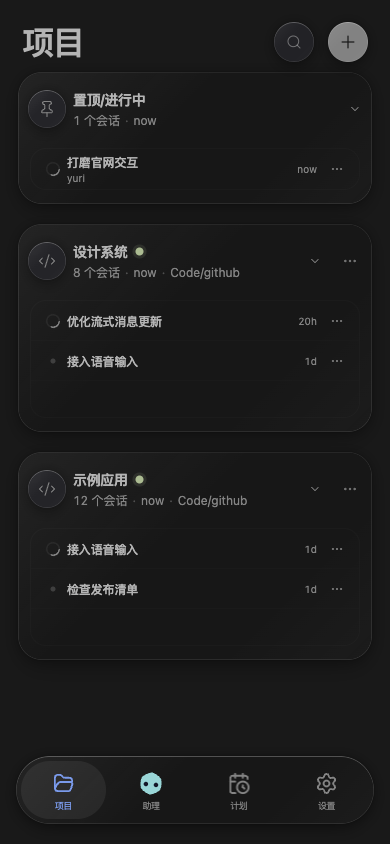
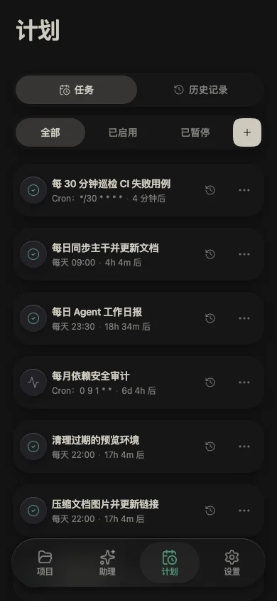

<p align="center">
  
</p>

# Yuri

**在电脑上与 AI 一起工作，在手机上接着聊。**

[English](README.md) · [官网](https://yuri.xiaobe.top/) · [下载](https://yuri.xiaobe.top/#downloads) · [使用手册](https://yuri.xiaobe.top/docs/)

Yuri 是基于 OpenCode 的 AI 工作台，支持编程、个人助理和计划任务。对话、文件、终端与预览集中在一个工作空间，可从桌面、iOS、Android、浏览器和 VS Code 访问。


## 可以做什么

- **编程与审查**：按项目组织会话，用 Worktree 隔离改动，查看 Diff 并完成 Git 提交。
- **交给助理**：保留持续的联系人对话，通过会话卡片跟进它分配的工作。
- **自动执行**：用 `/goal` 持续推进目标，或安排定时任务，在历史记录中查看结果。
- **连接设备**：手机配对主机，通过 Private Relay 远程访问，或从桌面端建立 SSH 连接。
- **语音与分享**：口述要求、朗读回复，将其他手机应用中的文字、链接和图片分享进来。
- **选择模型与工具**：配置模型、Agent、Skills、命令和 MCP，也可接入 Magpie 模型并查看聚合用量。

## 开始使用

1. 在存放项目的电脑上[安装 Yuri](https://yuri.xiaobe.top/#downloads)。
2. 打开项目，在设置中连接提供商，选好模型，开始会话。
3. 需要用手机继续时，[扫码配对这台主机](https://yuri.xiaobe.top/docs/connect-devices/)。

文件和执行留在主机上，远程访问与计划任务需要主机保持在线。各平台的具体入口与限制见手册。

<p align="center">
  
  
  
</p>

## 使用指南

[第一次会话](https://yuri.xiaobe.top/docs/quickstart/) · [个人助理](https://yuri.xiaobe.top/docs/assistants/) · [手机](https://yuri.xiaobe.top/docs/mobile/) · [语音](https://yuri.xiaobe.top/docs/voice/)

[目标](https://yuri.xiaobe.top/docs/session-goals/) · [计划任务](https://yuri.xiaobe.top/docs/scheduled-tasks/) · [SSH / Relay](https://yuri.xiaobe.top/docs/remote-instances/) · [Magpie](https://yuri.xiaobe.top/docs/magpie/) · [问题排查](https://yuri.xiaobe.top/docs/troubleshooting/)

## 参与开发

需要 Node.js 24、Bun 1.3.14，以及已安装的 OpenCode 运行时。

```bash
git clone https://github.com/yee94/yuri.git
cd yuri
bun install
bun run dev
```

开发桌面端使用 `bun run electron:dev`，开发 VS Code 扩展使用 `bun run vscode:dev`。

`packages/ui` 提供共享界面，`packages/web` 提供主机服务，`packages/electron`、`packages/mobile` 和 `packages/vscode` 负责平台集成。`site/` 将官网与 `packages/docs` 中的手册一起构建。

[贡献指南](CONTRIBUTING.md) · [反馈问题](https://github.com/yee94/yuri/issues) · [版本发布](https://github.com/yee94/yuri/releases)

## 致谢

感谢 [OpenChamber](https://github.com/openchamber/openchamber) 与 [OpenCode](https://opencode.ai) 提供的开源基础。

[MIT](LICENSE)，保留原有版权与许可声明。
