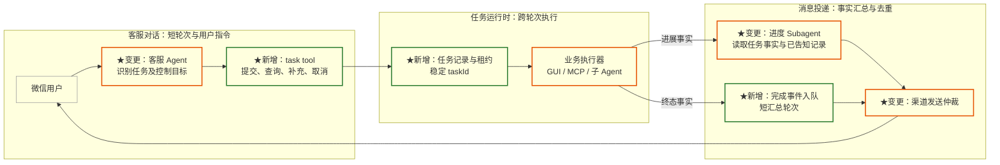
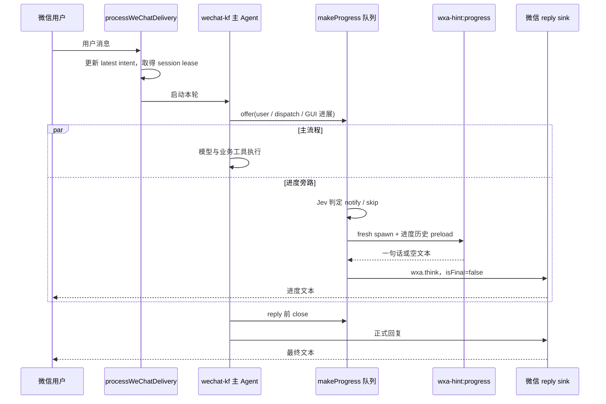
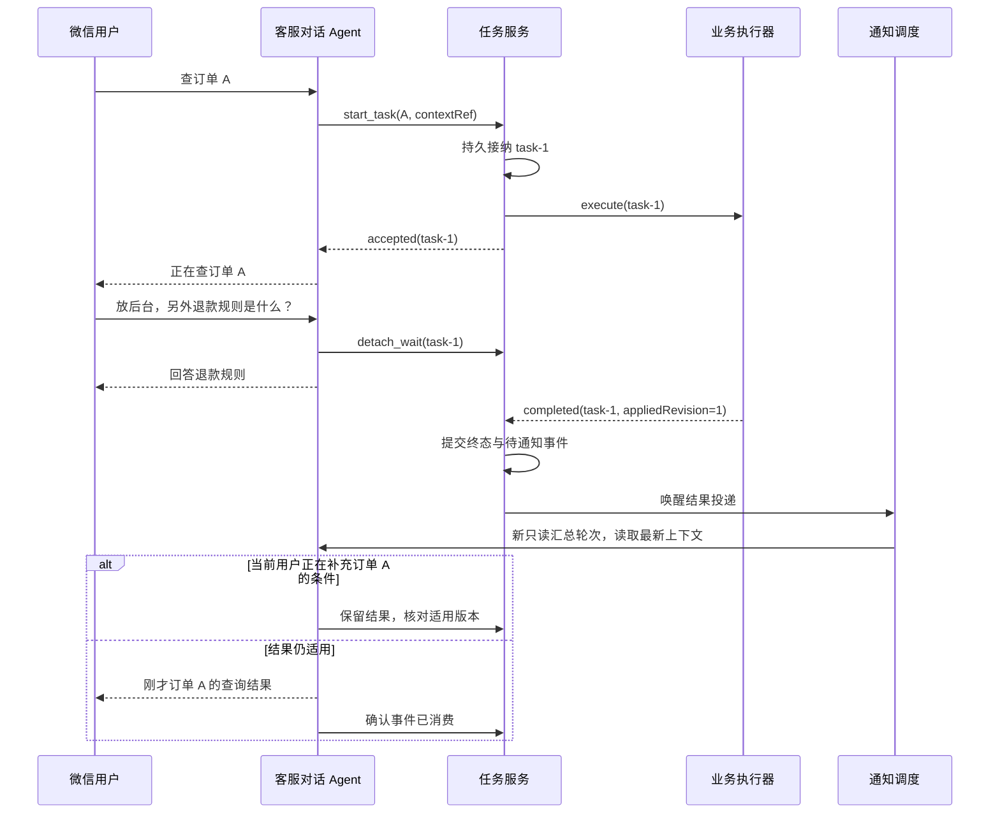

# 客服过程回复与后台任务：架构对比及演进方案

调研日期：2026-10-17。状态：**P1（GUI Job）已在 BFF 落地**；其余阶段仍为方案，未实施。

面向客服 Agent 与 OpenChamber 的架构、后端开发者，回答三个问题：过程回复应由谁生成；业务能力是否适合包装成 tool；怎样支持长任务执行期间继续接收用户指令。

本文将“过程预计”理解为接话、处理预期与进度说明。当前代码没有完成时间预测器；若需求包含数值 ETA，需要单独建设耗时估计，见 §9。

## 1. 结论

**保留轻量进度 Subagent，把长业务执行做成可寻址的 task tool，由独立任务运行时持有执行。对话 Agent 负责接收多轮消息、控制任务和汇总结果。**

1. 当前进度 Subagent 已经与主模型并行。把它改成模型可调用的 `progress` tool，不能解决长任务占用对话、新消息抢占旧执行的问题，反而多出一次主模型调度。
2. Tool 与 Subagent 可以组合：tool 是对外操作入口，Subagent 是一种执行方式，background 是运行时生命周期。推荐的 task tool 内部可以运行子 Agent、调用 GUI 服务或提交业务作业。
3. “完整上下文”应落实为**有来源、可读取的任务上下文**：派发时固定快照，后续条件通过显式指令补充，必要时按引用读取原始历史。每次复制整个主会话既不能保证最新，也不等于理解正确。
4. “移入后台”应解除对话对同一任务的等待，而不是取消后重新提交。任务从创建时就有稳定 ID 和独立 owner；foreground/background 仅决定等待及结果投递方式。
5. 客服当前的新消息策略是 latest-wins，会使旧 delivery 失去执行归属。要支持“查着订单，同时问退款规则”，必须将**对话消息的租约**与**业务任务的租约**分开。
6. 后台能力抽象为独立的 **Job**，Subagent 只是其执行器之一；不复用 `Spawn.background` 作为后台任务基础，见 §8.3.1。
7. 优先验证已有 GUI 作业的后台跟踪。它已有远端 `runId`，但当前中断只停轮询、不取消远端。是否能补充条件、真正取消，仍取决于远端 API；本次代码不能证明这些能力存在。

OpenChamber 提供最接近的本地参考：Contact 接单、`assign_session` 派发、worker 独立运行、完成后重新唤醒 Contact。Muse/Grok Bot 的公开行为也支持持续任务与多轮对话，但没有公开证据证明它们使用了与我们相同的进度 Subagent。

### 推荐架构



进度模型可以继续很小。新的工作量主要在任务 ownership、消息路由和结果投递，而不在换一种生成文案的 API。

## 2. 调研范围与证据边界

| 对象 | 证据 | 能得出的结论 |
| --- | --- | --- |
| yi-agent 客服 | 当前本地工作树源码、测试与规范 | 已实现的进度生成、抢占、GUI 跟踪及 core background 语义 |
| OpenChamberY | 当前本地工作树 Contact 模块源码及文档 | 助理/worker 分工、上下文窗口、排队和通知策略 |
| Meta Muse | 官方设计文章与 Meta 产品入口 | 多任务、可插话、后台完成后选择性通知等产品契约；内部调度结构未知 |
| Grok Bot | 官方文档，经 Context7 与原页面交叉核验 | 用户消息优先、异步 Bot handoff、长期记忆和云端执行；内部源码未知 |
| Guaca | 社区源码，固定 commit `15b143c5097b3a3d0f11eb6e163f5396addaccd6` | 可核验独立 coding job、inbox、steer 与恢复实现 |
| Errand | 社区源码，固定 commit `df83586d0f79f3176c69ea167d76965daa5cb68e` | 可核验客户端 follow-up、SSE 与重连；云端 runtime 不在该仓库 |
| Grok Build | 官方仓库的当前 background 文档 | 已开始的命令可转后台的行为参考；不能据此推断 Grok Bot 内部实现 |

本地代码引用以本次读取版本的行号为准，没有获取本地 Git 提交号；社区源码使用 commit 固定链接。未登录体验 Muse/Grok Bot，也未测量线上延迟、成本或回复质量。搜索到的同名 `wlsdks/muse-agent` 不是 Meta Muse，未混入产品对比。

下文 `Y:` 表示 yi-agent 仓库相对路径，`O:` 表示 OpenChamberY 仓库相对路径。主要证据集中在 §13。

## 3. 我们当前的方案：任务级文案侧车

**现状适合低干扰的进度表达，尚不是能独立接单的长期助理。**



队列 worker 内部等待子 Agent，但主业务不等这一轮文案。`round.suspended` 会 drain 进度队列，因此不能把“旁路”理解成所有生命周期边界都绝不等待。

### 3.1 实际契约

| 维度 | 当前行为 |
| --- | --- |
| 生成器 | `wxa-hint:progress`，`mode: subagent`，无工具，单次最多一个 iteration |
| 触发 | 用户入口、派发、部分失败/子代理 hint、GUI 聚合进展；不是所有原始工具事件 |
| 判定 | Jev 决定是否需要说话，500ms 超时；生成另有 2s 超时。它们是阶段预算，不是端到端 SLA |
| 上下文 | 首次注入最近最多 6 个用户轮次起点之后的对话投影，每条截至 800 字符，总历史约 6000 字符；后续续接自己的进度历史 |
| 主历史 | `context.mode: fresh`，没有继承主 Agent 完整 transcript |
| 续接 | 稳定进度 sessionId：父 session + 父 round；`session.start` 从父 RoundStore preload |
| 去重 | 事件 key、Jev 语义判定、已发布文本完全匹配三层 |
| 生命周期 | 请求 Scope 内 Queue/worker；父 RoundStore 保存可恢复状态，TTL 1800 秒；不是在途队列的持久化 |
| 收尾 | 正式 reply、无工具的模型收尾、round.end 等关闭；迟到进度不再发送 |
| GUI | 15s 窗口汇总，持续静默 40s 后最多一次等待安抚；没有 ETA 算法 |

### 3.2 优势与代价

| 优势 | 代价或限制 |
| --- | --- |
| 自动触发，不依赖主模型记住“先报进度” | 新类型的业务事实需要接入事件源，不能自行探索缺失事实 |
| 无工具、输入集中，较容易约束为一句话 | 无法接收“改成明天”并实际修改任务；增加历史也不会凭空获得控制能力 |
| 慢业务工具运行时仍能出接话 | 队列积压会让描述落后于真实任务；终态关闭可丢掉已经无必要的提示 |
| 文案失败不阻止业务 | 判定和生成通常是两段模型工作；还有持久化与发送开销 |
| 小上下文，隔离业务工具细节 | 早期条件被截断、事件摘要遗漏或二次转述，都可能损失信息 |
| 父 Round 关闭与取消逻辑集中 | 用户新轮次与长期任务不是同一生命周期，不能直接沿用这个 owner |

尤其要区分：进度 Agent 的 `messages` 是**它见过的进展与自己写过的文案**，不是新的业务事实源。它说过“正在查询”不能成为随后声称“查询成功”的证据。

### 3.3 多轮真正卡在哪里

`processDelivery.ts:34-58,108-118,139-160` 将新用户消息写为最新 intent。旧 delivery 的 monitor 或 `assertCurrent` 发现被替代后 abort。这一策略没有区分“查到哪了”“谢谢”“预算改为 500”和“取消”。

GUI 路径的差别更具体：`gui/tool.ts:110-135` 已保存远端 `runId`；`:165-213` 在中断时停止轮询，明确返回“远端任务不会被取消，也不会自动重跑”。因此可能出现**远端仍工作、当前会话已停止跟踪**的状态。不能把本地 `stopped` 展示成“业务已取消”。

## 4. OpenChamber 助理：可对话的协调者

**Contact 与我们的进度侧车不在同一职责层。Contact 更接近目标架构中的客服对话 Agent。**

### 4.1 已实现的分工

用户发消息后，服务先持久化并返回 admission，再进入 per-assistant lane。Contact 使用 pi harness，配置了读取历史、派工、watch、steer、stop 等工具；实质编码交给 OpenCode worker session。

`assign_session` 成功后结束本轮 mutation loop，再做 tools-disabled 的简短总结。worker 的完成/错误等事件更新会话卡，并触发只读 Contact continuation。用户可以继续找 Contact，而不是一直等 worker 的工具返回。

来源：`O:packages/web/server/lib/assistants/DOCUMENTATION.md:58,100-119`，`service.js:3007-3137`。

| 维度 | OpenChamber | 我们当前 |
| --- | --- | --- |
| 对用户说话的主体 | Contact 本人，既会接单也会汇总 | 主 Agent 正式回复 + 专用进度生成器 |
| 进度产生 | Contact 模型显式输出 `openchamber-message`，解析完成立即发布 | 事件触发 → Jev → 子 Agent |
| 长任务 | `assign_session` 交给独立 worker，派工轮次可以结束 | 业务通常仍受当前 delivery/runtime 约束 |
| 新消息 | Contact turn 串行排队；可以再调用 worker steer/stop | 最新 intent 抢占旧 delivery |
| 上下文 | Contact 最近 32 turns / 48000 字符窗口；越窗 memory/read_session 工具 | 小范围对话投影 + 进度专属历史 |
| 完成回访 | worker settle 后，重新启动只读 Contact turn | 原本业务轮次内产生最终回复 |
| 存储 | Contact SQLite + 上游 worker session，各自持有事实 | 父 RoundStore + 请求 Scope + BFF 共享存储 |

### 4.2 值得借鉴的部分

- **派工返回的是任务身份。** 后续能指向同一 worker，而不是重新描述后再开一个任务。
- **对话上下文与执行上下文分开。** Contact 知道用户的请求和 worker 状态，需要细节时读取 worker；不默认复制全部执行日志。
- **完成通知是新的执行入口。** 不是在已结束的 turn 上继续发旧 emitter。
- **工具结果先落实，再生成确认。** 工具执行和“我已经做完”的文本不是同一个事实。

### 4.3 不宜直接照搬的部分

Contact 的 lane 是串行的；它若自己调用长时间 `bash`，下一条消息仍会排队。快速响应依赖把重活派给 worker，并不只是因为 UI 允许输入。

`service.js:3045-3048` 在新用户消息入场时取消自动 continuation，并对该 Contact 的 watches 设置 `resume_allowed=0`，只有显式 assign/watch 才重启对应 watch 的通知资格。该策略可以避免旧总结插话，但用于客服时可能造成：“用户问了另一个问题，之前查订单的结果不再自动告知”。推荐保留结果待通知记录，按 task 重新判断相关性，不全局永久关闭。

OpenChamber 的完成 continuation 是只读，这适合“告知结果”。若希望完成后继续自动推进下一个业务步骤，应由任务执行器负责，而不是把通知轮次偷偷升级成可写业务轮次。

Contact 活动、lane、AbortController 为进程内状态；已有 worker watch 有重启 reconcile。不能据此宣称所有 Contact 在途操作都有完整持久化恢复。SQLite 与进程内 lane 也不能直接替代客服多实例 TTLData/CAS。

## 5. Muse、Grok Bot 与社区实现

### 5.1 官方产品：能够确认什么

**Muse 更接近一个长期个人助理；Grok Bot 更强调可协作的具名 Bot。两者都把任务生命期扩展到了单轮问答之外。**

Meta 的《How We Designed Muse》明确描述：用户不必等待上一条回复，可以中断、同时交付多个任务；任务在计划或事件触发下继续；后台结果只有“有意义的新信息或需要用户输入”才通知。它同时提供主聊天、side chats、活动视图与 Goals。其“先判断值不值得说”与我们的 Jev 门控目标相近，但文章没有透露是否使用独立生成 Agent、用了几个模型调用，或如何锁住任务。

Grok Bot 官方 `Message and collaborate` 明确支持进行中继续发指令，用户直接消息优先于后台工作，能够重定向当前 turn；Bot 间消息异步发送，接收 Bot 被唤醒后处理并稍后回复。官方也说明长期记忆是偏好、事实和历史摘要，不是每次重放所有对话。

不能从这些交互推出“它们都给 tool 完整 transcript”“每个工具都可运行中转后台”或“新消息一定不会取消任何旧任务”。这些属于未公开的实现细节。

### 5.2 Guaca：源码可验证的后台 job

Guaca 明确声明受 Grok Bot 启发，并非其 clone。它提供两个不同层次的多轮机制：

| 层次 | 源码行为 | 对我们的启发 |
| --- | --- | --- |
| 对话 Agent | 每个 actor 有 inbox；工具轮次之间 `take_in` 吸收 Human/System 消息；peer 消息另行调度 | 运行中接受新条件需要消费边界，不能只存一条“已收到” |
| coding job | `code` 非阻塞启动独立 `job_run`；运行中用 `Control::Steer` | 长业务有独立执行身份；调用方 turn 不必一直存活 |
| 后端差异 | Claude mailbox/hook、Codex `turn/steer`、pi RPC steer | steer 需要执行器能力，不能靠给通用 tool 加布尔值实现 |
| 完成 | `job_finished` 构造 System envelope 并 `deliver` 到 Agent inbox | 完成事实必须可调度；仅给 UI 发 SSE 不足以唤醒汇总 |
| 进度 | `CodingProgress` 是临时 UI 事件，完成通过持久消息投递 | 高频进度和最终结果可用不同可靠性预算 |
| 恢复 | drain/put_down/pick_up；未知中途副作用走 interrupted，而非盲目重做 | 自动恢复必须建立在执行 checkpoint 或外部任务 ID 上 |

关键源码：`runtime/mod.rs:2571-2866,2969-3087,4349-4385,4898-4964`。固定链接见 [G1]—[G4]。

其 actor/inbox 与 coding job 的分工比“专用进度 tool”更值得借鉴。不过它是单 host 的 Rust/SQLite 运行时，不提供我们 BFF 的多实例租约方案；也没有证据表明任意在途普通 tool 都能迁移 owner。

### 5.3 Errand：客户端契约参考，不是任务运行时源码

Errand 的 `sendMessage` 读取最新 run，首次调用 `/runs`，之后调用 `/runs/{id}/follow-ups`。UI 会把旧 streaming 消息标成 interrupted，但这不等于服务器已经 cancel，或保证即时 steer。

其历史来自云端 runs 与事件 replay，前端通过 SSE 展示 assistant 文本和工具活动，断线后重拉权威结果。本仓没有独立后台任务调度器、模型上下文编译器或云端恢复算法；这些不能从 README 的“persistent teammates”推断出来。

该版本还存在预留功能：approval HTTP 适配返回空/`contract_pending`；“Stop generating”按钮在 sending 时 disabled，没有对应取消调用。它适合参考 Agent/Run/Event 的客户端分层，不适合作为“后台控制已经做完整”的证明。[E1]—[E3]

### 5.4 Grok Build：与“移入后台”直接相关的参考

Grok Build 当前官方文档明确区分：创建时 `background:true`，与命令已运行后发送新消息/快捷键使其转后台。任务返回 ID，结果可查询，完成可唤醒对话；中断等待不等于杀任务。[B1]

本次 raw 文档与 Context7 都显示转后台快捷键为 `Ctrl+B`，搜索摘要仍出现旧的 `Ctrl+G`，说明不能把搜索摘要当成当前 API 契约。本文只借鉴“解除等待、保留任务”的语义。

同一文档还明确：定时任务在 detached subagent 中执行，看不到原对话，prompt 必须自包含。**即使成熟工具支持 background，上下文也不是天然完整。** Grok Build 与 Grok Bot 是不同产品，不据此推断后者内部实现。

## 6. 四种选择的取舍

| 方案 | 接话控制 | 上下文 | 多轮长任务 | 主要成本 | 建议 |
| --- | --- | --- | --- | --- | --- |
| A. 保留进度 Subagent | 自动门控、容易统一风格 | 事实投影，信息有边界 | 单独不解决 | Jev + 生成调用，事件接入维护 | **保留作为表达层** |
| B. 主模型调用 `report_progress` tool | 与业务意图贴近，但可能漏报 | 可读取主轮次快照 | 单独不解决 | 工具轮次、主模型时延、模型调度不确定 | 不作为核心改造 |
| C. 把进度生成封成内部 tool | 可统一调用记录，但行为基本不变 | 取决于宿主注入 | 单独不解决 | 多一层 wrapper，收益需证明 | 仅有统一工具协议需求时做 |
| D. 对话 Agent + task tools + 独立任务执行器 | 主动沟通与事件通知结合 | 对话上下文 + 可读取的任务上下文 | 支持，前提是 ownership/路由/回收完整 | 持久任务、控制命令、通知调度 | **目标方案** |

若需求仅为“接话更准确”，选 A 并增强事实输入即可。当前需求还要求用户多轮调整与后台执行，应走 D，同时复用 A。没有必要先把 A 改成 B，再建设 D。

成本也要分开评估：A 的每次候选进度成本约为 `Cjudge + P(notify) × Cgenerate`；让主 Agent 报进度并不一定更便宜，可能增加主模型轮次。D 增加协调与完成汇总的成本，价值在交互能力。没有线上样本，不给出节省比例或绝对延迟承诺。

## 7. “拥有完整上下文”的具体契约

**任务能够取得所需原文，比向每次模型调用塞入全部历史更重要。**

把上下文分成三份，避免进度模型与执行器拥有相同权限和输入负担：

| 消费者 | 默认输入 | 需要时读取 |
| --- | --- | --- |
| 对话 Agent | 最近对话、当前用户消息、活跃任务摘要及版本 | 老对话、任务原始结果 |
| 业务任务执行器 | 目标、约束、相关原始消息、附件引用、派发时上下文快照 | 允许范围内的历史、外部当前事实 |
| 进度生成器 | 当前目标、已应用条件版本、已验证进展、已告知内容 | 通常不额外读历史；缺少依据时不扩写 |

建议的概念结构如下。它们是新方案示意，**不是现有 yi-agent API**：

```ts
interface TaskContextRef {
  conversationId: string;
  sourceMessageIds: readonly string[];
  historyUpperBound: string;
  snapshotRef: string;
  attachmentRefs: readonly string[];
}

interface TaskInput {
  goal: string;
  constraints: readonly string[];
  context: TaskContextRef;
  inputRevision: number;
}

interface TaskReceipt {
  taskId: string;
  state: 'queued' | 'running' | 'waiting_input' | 'completed'
    | 'failed' | 'cancel_requested' | 'cancelled' | 'uncertain';
  desiredRevision: number;
  appliedRevision: number;
  resultRef?: string;
}
```

`historyUpperBound` 固定派发时可见范围，避免排队中的未来消息意外进入旧任务。新条件通过显式 command 推进 `desiredRevision`，执行器确认接纳后才推进 `appliedRevision`；不能把“收到补充”说成“已经按新条件执行”。

上下文由宿主从权威历史构建，tool 参数只承载目标和引用，不能要求主模型手写完整 transcript。检索只能进入所属用户、会话和任务许可的范围；不包含隐藏推理。原文保留角色、工具调用与结果关联、错误状态以及来源 ID，摘要不能冒充原文。

首期不建立新的全局记忆库。复用现有历史存储和附件引用，只保存重建任务所需的快照或有保留期保证的引用。若原历史可能比任务先过期，必须在任务接纳时留存所需片段，不能把悬空引用称为可恢复上下文。

## 8. Task tool 与运行时设计

### 8.1 最小操作面

模型可见能力从以下操作开始；命名在实施时对齐现有工具风格，不要求建一个通用“任意工具执行器”。

| 操作 | 返回 | 契约 |
| --- | --- | --- |
| `start_task(goal, …)` | taskId、当前状态 | 持久接纳成功后才确认；执行仍未必成功 |
| `get_task(taskId)` | 权威状态、事实、结果引用 | 查询不重启任务、不取消任务 |
| `update_task(taskId, instruction)` | commandId、desired/applied revision | 不支持 steer 的执行器明确返回限制 |
| `cancel_task(taskId)` | 已请求取消/已取消/无法取消 | 只有执行器确认停止才报告 cancelled |

“放后台”是宿主控制操作 `detach_wait(taskId)`：用户入口或等待预算到期可直接触发，不必等待忙碌中的模型先调用工具。需要自然语言入口时由对话 Agent 路由到同一控制面。

### 8.2 前台与后台使用同一条提交路径

1. 所有支持后台的任务先经过 `submit`，获得稳定 taskId 和独立任务 Scope。
2. 前台只创建一个可取消的 waiter。任务在短等待预算内完成时，可以直接交付结果。
3. 用户继续发消息、主动要求后台，或等待预算耗尽时，解除 waiter；执行器继续运行。
4. 原 tool call 闭合一次：返回 completed result，或明确的 accepted receipt。之后不能把同一个 tool result 改写成另一份最终结果。
5. 后台完成产生独立 task event，进入通知队列，按当前对话状态生成新的回复。

等待预算应依据线上耗时分布评审，首期可先只支持显式后台，不引入任意的自动阈值。若开启自动转后台，应在接单时讲清“处理好后再告诉你”，避免沉默结束被误解为失败。

**完成与 detach 同时发生时**，通过任务版本和唯一 completion event 决定唯一交付路径：要么前台拿结果，要么前台拿 receipt、后续通知；不得两边各发一次完成结论。

普通在途 tool 若最初绑定父 run、没有稳定任务 ID、依赖父 emitter/上下文闭包，就不能直接改一个 flag 后移出 Scope。首期只让明确声明可 detached 的执行器走该路径；不尝试任意 fiber 的运行中迁移。

### 8.3 为什么不能直接用现有 `background:true`

| 现有能力 | 限制 |
| --- | --- |
| core `Spawn.background` | 默认后台超时 10s；子任务登记到父 run；父 finalize 会 drain，abort 会 cancelAll |
| runtime `handle.spawn` | 明确拒绝 `background:true` |
| core `Task` tool | 前台等待、fresh 上下文；子挂起作为失败处理 |
| inbox queue/steer | 有同进程执行机制；不能代替 BFF 跨请求共享命令队列 |
| 客服 Executor FiberMap | 可在服务 Scope 执行 delivery；当前 intent/lease 仍是 delivery latest-wins |

来源：`Y:packages/core/src/spawn/Spawn.ts:9-129`、`spawn/task.ts:15-59`、`loop/runLoop.ts:819-847`、`packages/runtime/src/createSession.ts:483-508`。

这里的 `background` 是父执行生命周期内的并行子工作。它不等于“主对话已经结束，任务跨多轮继续”。目标方案在 BFF 任务运行时新建执行 owner，里面仍可使用现有子 Agent 和 Effect Scope；无需先修改 core drain 契约。

### 8.3.1 决策声明：后台能力抽象为 Job，不复用 Subagent background

**后台执行抽象为独立的 Job 能力。Subagent 只是 Job 的一种执行器，`Spawn.background` 不作为后台任务的实现基础。**

| 维度 | `Spawn.background`（现有） | Job（目标） |
| --- | --- | --- |
| 生命周期 owner | 父 run；父结束 drain、abort/superseded 时 cancelAll | 会话级 Job 运行时；与对话轮次解耦 |
| 新消息 | 父 run 被 superseded，子任务随之取消 | 不影响 Job，按 jobId 查询/补充/取消 |
| 超时 | `timeoutMs` 到期即中断执行 | 等待预算与执行 deadline 分开；停止等待不停止执行 |
| 身份与控制 | 只有 runId；仅支持按父 run `cancelAll` | 稳定 jobId；get / update / cancel / detach 按 id 寻址 |
| 状态 | 进程内 `Map` 与事件 buffer，不可冷恢复 | TaskRecord 持久化、租约与 fencing，可 reattach |
| 结果投递 | `spawn.completed` 只在父请求存活期间可见 | 终态事件持久化后再投递，可唤醒汇总轮次 |
| 执行器 | 只能是 Agent loop | 子 Agent、远端 GUI 作业、MCP/业务作业；GUI 无需套一层 LLM |

声明的边界：

1. `Spawn.background` 保持现有语义，继续服务轮次内的短旁路（如 hint bridge），不扩展其生命周期、不改 core drain/cancelAll 契约。
2. 不在业务 tool 的 call 内直接 `spawn({ background: true })` 充当后台任务；那只能得到“本轮内并行”，且会把父请求拖到子任务结束，新消息到达时任务仍会被取消。
3. Job 执行器为子 Agent 时，在 Job 自己的 Scope 内调用 Spawn（前台模式），由 Job 而非对话 run 持有该 Scope。
4. 命名使用 Job，避免与 core 已有的前台 `Task` tool（`packages/core/src/spawn/task.ts`）混淆；面向模型的工具名在实施时统一评审。
5. 首期落点在 BFF 任务运行时；待第二个宿主（如 TUI、A2A）出现相同需求，再评估是否下沉为 yi-agent 扩展包。

### 8.4 状态、持久化与恢复

任务执行状态与等待模式分开。`running` 任务既可有前台 waiter，也可无人等待；不为两种呈现方式各建一套任务记录。

| 状态/资源 | owner | 存活与回收 | 恢复来源 |
| --- | --- | --- | --- |
| TaskRecord | BFF 任务服务，按用户/会话/taskId 隔离 | 活跃时续期；终态保留期配置；可先与现有 delivery 的 7 天对齐，评审后定值 | 共享存储权威记录 |
| 外部执行 ID/checkpoint | TaskRecord 内执行器字段 | 跟任务走，不另建权威任务表 | 外部服务 `getRun` 或已有 session 历史 |
| worker lease + fencing token | TaskRecord 的当前执行 owner | 心跳续约；完成/失租释放；旧 owner 禁止晚写 | CAS 抢占新 lease |
| 在途 fiber / waiter | 服务 Layer 内 task Scope / 对话 Scope | 各自终止时释放；waiter 取消不传递为任务取消 | 不恢复内存对象 |
| 待处理 command | 对应 task 的持久 mailbox | applied/rejected 后压缩；保留必要审计信息 | TaskRecord 或所属命令存储 |
| 结果与待投递事件 | TaskRecord 终态及 outbox | 投递确认/策略消费后标记；随任务终态保留期回收 | 同一权威任务状态 |
| 进度去重/已告知 | 对应任务的通信状态 | 完成后停止生成；记录已发布内容 | 共享任务通信记录 |

TTLData 本身不是持久任务队列。生产后台能力还需要一个**可发现的待执行集合或持久队列**，以及启动/周期恢复入口。若沿用 TTLData，需要核实可扫描索引与 CAS 能力；若使用既有消息设施，任务记录仍是权威源，队列只提供唤醒。

建议让持久接纳同时留下可发现的 `queued` 状态。实际队列投递失败可从待执行索引补投；worker 领取时再 CAS lease。不要依赖“写好 TaskRecord 后启动本地 fiber”就承诺重启可恢复。多个存储操作没有事务时，应写明补偿/reconcile 顺序；不假设存在跨 key 原子事务。

终态与 pending notification 在同一可原子更新的记录中提交，dispatcher 根据唯一 `(taskId, resultRevision, eventSeq)` 领取。若外置 outbox，必须有从终态补建 outbox 的 reconcile，避免终态写成但事件丢失。

恢复策略按执行器区分：远端可查询的 GUI job 重新 attach；有 checkpoint 的 Agent 会话继续；未知外部副作用转 `uncertain` 并查证，不重新提交。TTL 到期不能承担业务取消职责，执行 deadline 与存储保留期分别定义。

### 8.5 GUI 首期适配

GUI 已有 `postRun/getRun/runId`，可复用提交去重与路由记录，但需要把这些记录的权威归属迁到 TaskRecord，或由 TaskRecord 引用唯一既有记录；不能双写两份 run 状态。

第一阶段仅提供 start/status/attach/final-result。对 `update_task`，若远端没有更新接口，返回“该执行器不能中途修改”，并由对话询问或按用户明确指令决定后续动作。对 cancel，只停止跟踪时应返回 `tracking_stopped` 之类的明确控制结果，不能写成业务 `cancelled`。

GUI 当前 `completed` 结果带 `businessOutcome: unknown`（`gui/tool.ts:200-206`）。后台版本仍要保留：执行器结束，不等于订票、下单等业务已成功。

## 9. 进度与最终回复如何生成

**保留“有新事实才说话”的门控；增加任务归属、事实版本与投递仲裁。**

进度源优先使用结构化事实：任务已接纳、外部执行已启动、阶段结果、失败、需要补充输入。内部点击次数、重试次数、排队子阶段变化通常不值得各发一条消息。沿用现有 GUI 汇聚机制，同时给待处理队列设置容量/合并规则，避免旧进度长期排队。

进度生成输入建议包含 `taskId`、目标、`appliedRevision`、事实引用、当前状态和已告知文本。发送前核实任务仍在对应状态；若终态已到达，丢弃尚未发送的“仍在查询”。已成功发送的微信文本不追溯撤回。

短任务沿用现有 Round 进度链路。后台任务的进度账本应归 task，不能继续借用已经结束的父 Round。可复用 prompt/Jev 和生成逻辑，但将取状态与投递封装放在任务插件边界。

完成汇总读取**权威结果 + 当前对话摘要 + 原任务目标**，作为新一轮只读汇总，避免重新执行业务。新用户消息可打断这次汇总；结果事件仍保持待处理，稍后重新判断，不永久丢掉。

原 `wxa.think` 可继续承载活动轮次内进度。跨轮次结果不能持有旧 `EventEmit` 再发，也不能冒充旧 round 的 `final:0`。应由新的合法通知执行上下文产产品事件，再经渠道发送模块投递。此处确实需要扩展 BFF 请求驱动/下行边界：现有 hook 无法在已销毁的 run 上执行，现有 wire 也只处理当前执行流。

### 时间预期与 ETA

当前 40s 是一次性等待安抚触发条件，不是剩余耗时预测。默认使用“还在查询”“已查到 A，正在核对 B”等有证据的表达，不生成虚构百分比和完成时间。

若产品确实要“预计还要多久”，由执行器队列状态和同类任务耗时分布提供估计区间、样本范围和更新时间；生成器仅转述。缺少可用估计时明确不报数。是否建设 ETA 应由用户需求和可用执行数据决定，不与这次后台任务改造绑定。

## 10. 多轮消息与任务控制

**新消息应优先进入对话，但是否终止业务由消息意图与任务目标决定。**

| 用户消息 | 对话处理 | 原任务处理 |
| --- | --- | --- |
| “查到哪了？” | 读状态后简短回答 | 继续执行 |
| “谢谢” | 正常接话 | 不取消，不关闭最终结果通知 |
| “预算改成 500” | 定位任务、提交 update | 支持 steer 才应用；报告 accepted 与 applied 的区别 |
| “先放后台，我问个别的” | 解除前台 waiter，开始新轮次 | 同 taskId 继续 |
| “不用查了” | 定位明确任务，优先发 cancel | cancel_requested，收到执行器确认后 cancelled |
| “再查一笔订单” | 创建新 task；标明对应订单 | 旧任务继续，按资源约束排队/并行 |
| “别做 A，改做 B” | 明确替换关系 | 先处理 A 的取消/不可取消状态，再接纳 B |
| 对旧任务回复“改成明天” | 按回复关系定向旧 task | 不默认改最新任务 |
| 多个任务下说“取消那个” | 目标不唯一时问清 | 不猜测、不全停 |

任务选择优先级：显式 task/回复关联 → 当前唯一相关活跃任务 → 对话语义匹配 → 澄清。自然语言分类只负责路由提议；实际状态变化由工具和 CAS 校验执行。

用户指令的优先级高于自动汇总，但不等于覆盖整个会话所有 task 的版本。每个任务独立保存 desired/applied revision；对话另有发送仲裁，避免多个完成结果同时抢话。通知在插入前带清楚任务对象，例如“刚才那笔订单查到了……”。



新消息没有释放任务租约，只改变对话等待方式。若用户明确取消，走单独的 task cancel 命令。

### 必须覆盖的竞态

| 竞态 | 约定 |
| --- | --- |
| 新条件入场时旧结果完成 | 保留旧结果版本；不能宣称已符合尚未 applied 的新条件 |
| cancel 与完成同时到达 | CAS 选择权威状态；已完成副作用不回滚，向用户报告事实 |
| 旧 worker 失租后返回 | fencing token 阻止写入；不能覆盖新 owner |
| 自动汇总生成时用户插话 | 取消旧生成；结果仍待处理，按新对话重评 |
| 同一完成事件重复送达 | 唯一 event ID 去重，防止重复汇总及重复发送 |
| 微信发送成功但确认丢失 | 记录 ambiguous，按渠道查询/幂等能力处理；不宣称端到端 exactly-once |
| 单设备上多个 GUI 任务 | 按真实资源能力串行，不因多个 taskId 就允许同时操作同一界面 |

## 11. 落地顺序、边界与验证

### 11.1 分阶段实施

| 阶段 | 交付 | 验收与退出条件 |
| --- | --- | --- |
| P0：基线 | 回放当前接话，统计误报、重复、取消后晚发和进度成本 | 确认现有 Subagent 的质量问题与多轮 ownership 问题各占多少 |
| P1：单执行器试点（2026-10-17 已落地） | 实际：GUI Job 的持久接纳、独立租约、按 jobId 显式接续、同 appid 串行拒绝、前台等待可被新消息打断。无主动推送，不复用进度生成器。仅 GUI | 实际：下一条用户消息的 round.start suffix 交付；恢复按会话触发。旧 delivery 结束不丢已接纳的远端跟踪。原“完成即通知”未做 |
| P2：任务化多轮 | 持久控制命令、任务定向、支持执行器的 steer/cancel、通知重评 | 更新条件有 applied ack；新消息不全局关通知；目标不明确会澄清 |
| P3：前台可转后台 | 同一任务提交路径、可取消 waiter、短等待与 detach 竞态处理 | 转后台不二次 postRun、不重建任务、不重复完成回复 |
| P4：扩展执行器 | 按真实需求接 MCP/业务子 Agent；可重用接口成熟后再考虑提包 | 每个适配器声明 attach/update/cancel/recover 能力和测试证据 |

P1 已在 BFF 落地，小于本表原计划。无微信主动推送；完成结果在该会话下一条用户消息经 `round.start` suffix 交付。恢复由该会话下一轮 reconcile 触发，不是全局扫描。仅 GUI 执行器。文件与偏差见 §11.5。

P1 对“不支持中途更新/取消”的执行器如实返回限制。持久接纳与恢复发现机制必须在承诺生产级后台前完成；只启动服务 Scope fiber 的实验版不能宣称具备重启恢复。

### 11.2 对现有契约的影响

保持：普通短任务接话不阻塞主模型；skip 不调用生成模型；主模型与 hint 的身份/风格分离；进度不冒充 final；真实业务结果不被改写成成功；终态和明确取消后无旧进度晚发；共享存储 OCC 仍由仓储层负责。

计划改变并需评审确认：客服新用户消息不再一律取消旧业务；长任务脱离父 Round；跨轮次可主动投递结果。它们是产品行为变化，不应藏在“把 Subagent 改成 tool”的重构里。

新增任务能力默认落 BFF 插件、工具、持久化与渠道执行服务。现有 observe hook 仍只接收事实/入队；不要在 `events.observe` 擅自增加 spawn 权限。core 不引入微信任务语义，不新增 Run/suspend/resume hook，不改嵌套挂起传播。

pipeline/wire 的必要改动限定为：接纳/恢复 task 事件，建立新的合法通知执行上下文，以及跨轮次发送仲裁。现有 hook/插件可以完成进度生成，不能单独完成已结束请求之后的调度和投递；这就是边界变更的具体理由。

### 11.3 建议文件变更范围

下表是后续实施落点，不表示本次已修改。`src/service/yi/` 以下路径均属于 yi-agent BFF。

| 路径 | 建议变化 |
| --- | --- |
| `plugins/wechat/progress.ts`、`thinkHint.ts` | 保留生成门控；抽出实际被两种 owner 复用的部分；新增 task 来源时避免循环触发 |
| `plugins/wechat/gui/tool.ts` 及现有 GUI 状态 owner | 提交/等待分离；沿用远端 runId 和提交去重；统一状态权威 |
| `plugins/wechat/tasks/`（拟新增） | task tools、控制命令和执行器适配；不做无实际调用方的通用工具框架 |
| `persistence/` 下任务仓储（拟新增） | TaskRecord、CAS lease、上下文引用、pending events 与恢复发现 |
| `wechatKfExecutor.ts`、`pipeline/wechat/processDelivery.ts` | 对话 delivery 与任务 Scope 分离；旧 intent 只抢占对话执行 |
| `pipeline/wechat/`、`wire/wechat/` | 新通知执行入口与发送仲裁；复用产品事件和渠道发送能力 |
| `sessions/wechatKf.ts` | 装配 task 插件；按执行器切流 |
| `test/yi/` | 公开行为、跨实例、恢复与竞态验证 |
| BFF 渠道文档、全局架构图/索引 | 同步 owner、生命周期和消息规则 |

OpenChamber 目前仅作为参考，不需要为落地客服方案同时改其生产代码。若后续改善 Contact 的全局 `resume_allowed=0` 策略，应另立需求，不能顺带改掉已有约束。

### 11.4 验证场景与指标

| 场景 | 应观察的结果 |
| --- | --- |
| progress 判定/生成很慢 | 主业务可继续，终局关闭后不晚发 |
| long task 后连续问两句无关问题 | 两句按对话规则处理，原任务持续执行并能最终告知 |
| 同任务连续更新条件 | 命令顺序可追溯，desired/applied 分开，旧结果不冒充新结果 |
| 前台等待时 detach | 外部提交一次；原 call 闭合一次；最终通知一次 |
| 完成快于任务注册/监听建立 | 结果不会丢失；以记录状态为准，不只靠瞬时事件 |
| 实例重启或 lease 失效 | 可 attach 的任务恢复跟踪；不确定副作用不自动重跑 |
| 重复 delivery/command/completion | 幂等，不增开业务作业 |
| 远端不支持 cancel/steer | 如实报告能力限制，不假成功 |
| 多个 GUI 任务争用同一设备 | 资源互斥，状态说明准确 |
| 通知生成期间新消息到达 | 旧文案可取消，结果仍可回收，终态不丢 |

沿用 `wechat-progress.test.ts`、`wechat-thinkHint.test.ts`、GUI progress 测试中的公开行为断言；新增测试走真实装配、可控模型/执行器边界，不扫描源码字符串来证明正确性。

观测指标包括：首个有效接话耗时、无新增事实消息占比、错误成功承诺、取消后晚发、提交到 applied 延迟、后台完成到告知延迟、重复外部提交、未知结果比例、每任务生成成本。P0 采集基线后再定阈值；关键正确性验收要求不能重复外部提交、不能将未确认取消说成成功。

回滚按新任务入口切换，已有后台 task 继续由原 owner 跟踪至终态；不能关闭开关时直接丢弃在途任务。避免新旧执行路径同时成为同一任务的写入方。

### 11.5 实施记录（2026-10-17）

P1 落在 yi-agent BFF。core 与 pipeline/wire 未改。`gui_run` 的 toolCallId 提交去重仍在 `kfRecall` route claim；受理后 admit Job 并等待。

| 路径 | 作用 |
| --- | --- |
| `app/wxaaiagentnodelogicsvr/src/service/yi/jobs/types.ts` | Job 契约：记录、租约、notice、`jobKey` |
| `app/wxaaiagentnodelogicsvr/src/service/yi/jobs/store.ts` | 单会话聚合槽，CAS |
| `app/wxaaiagentnodelogicsvr/src/service/yi/jobs/runtime.ts` | `makeJobRuntime` |
| `app/wxaaiagentnodelogicsvr/src/service/yi/jobs/process.ts` | 进程级 Scope |
| `app/wxaaiagentnodelogicsvr/src/server.ts` | 与 `startWechatKfExecutor` 并列启动，`WXA_WECHAT_RELAY_ENABLED==='1'` |
| `app/wxaaiagentnodelogicsvr/src/service/yi/plugins/wechat/jobs/guiExecutor.ts` | 包装现有 `pollGuiRun`；无远端取消，中断只停跟踪 |
| `app/wxaaiagentnodelogicsvr/src/service/yi/plugins/wechat/jobs/plugin.ts` | `wxaWechatJobsPlugin`：`round.start` suffix，`round.end` 标交付 |
| `app/wxaaiagentnodelogicsvr/src/service/yi/sessions/wechatKf.ts` | 插件注册在 `wxaKfGuiPlugin` 之前 |

与 §11.1 / §11.3 的偏差：

| 计划 | 实际 |
| --- | --- |
| 完成后通知用户 | 无微信主动推送。`subscribe` 的 `job.progress` / `job.settled` 只留给以后的外层接入 |
| 继续复用进度生成器 | 下一条用户消息的 `round.start` DynamicBlock suffix 列出 running 与 pending 结果，不写入历史。`round.end` reason=`completed` 把本轮注入结果标 delivered；`aborted` 保持 pending。至多一次 |
| 全局可发现的恢复 | 该会话下一轮 reconcile。TTLData 无 scan。会话不再来消息则不跟踪，直到 7 天 TTL；远端 GUI 继续跑，结果不回收。重新接管后轮询预算从头计 |
| `plugins/wechat/tasks/`、`persistence/` 任务仓储，以及 pipeline/wire 新通知入口 | 仅 GUI。落点是 `jobs/` 与 `plugins/wechat/jobs/`。pipeline/wire 未改 |
| 显式 detach、更新、取消 | 新消息只停等待者。没有远端取消接口。P1 无 update/cancel |
| 前台完成即工具终态 | 前台等待者先 acknowledge 再把结果交回模型。后台完成没有 `tool.completed`，Langfuse `onGuiCompleted` 不触发，也不发 weapp card |
| 重启即可恢复 | 持久记录在。只用进程级 runtime，未启动时 `gui_run` 直接失败，没有会话级降级。不能把只启动 Scope fiber 说成全局重启恢复 |
| GUI 状态权威迁到 TaskRecord | route 记录只保留按 toolCallId 的提交去重，不再写执行终态；执行状态与结果只在 Job 里 |

任务只按 jobId 寻址，不按 intent 文本判断同一任务。round.start 注入的任务行带 jobId；`gui_run` 带 jobId 时接续等待该 Job，不第二次 POST。同 appid 已有 running Job 时，不带 jobId 的提交被拒绝并返回 jobId（同设备 GUI 串行）。

## 12. 决策边界与剩余问题

| 风险/待核验项 | 处理 |
| --- | --- |
| GUI 更新/取消接口是否存在 | 对接实际后端契约；当前源码只证明 post/get 与停止本地跟踪 |
| TTLData 是否支持足够的恢复发现能力 | 选定共享索引或已有持久队列；实现前验证，不假设 KV 自动调度 |
| 微信主动结果投递限制 | 核验实际渠道时窗、幂等/查询能力；过窗保留结果待用户回访，不能无限重试 |
| 任务期间持续新消息导致通知饥饿 | 结果持久待投递，用户优先后重新调度；查询状态可直接消费相关结果 |
| 完整上下文导致费用与噪声增长 | 快照+相关片段+按需原文；观察误答与 token，而不是只扩大窗口 |
| 不同结果语义 | executor completed、业务 success、通知 delivered 分开保存 |

本方案不建设新的多 Bot 社交系统、通用记忆平台或任意工具进程迁移。对比 Muse/Grok Bot 是为了选择当前需要的任务生命周期与多轮交互契约。

最终建议是：**接受“业务能力工具化、任务独立运行”的方向；继续使用专门的进度表达器；把完整上下文改成可追溯的上下文访问能力。** 首期证明一个远端 GUI 任务能跨越多轮聊天并可靠交付结果，再扩展到更多执行器。

## 13. 证据索引

### 本地 yi-agent

| 编号 | 路径与行号 | 支撑结论 |
| --- | --- | --- |
| Y1 | `app/wxaaiagentnodelogicsvr/src/service/yi/plugins/wechat/progress.ts:12-44,83-185,194-220` | 进度 prompt、RoundStore、Jev/生成预算、独立 worker 与关闭 |
| Y2 | `app/wxaaiagentnodelogicsvr/src/service/yi/plugins/wechat/thinkHint.ts:30-111` | 注册子 Agent、preload、事件入口和 lifecycle |
| Y3 | `app/wxaaiagentnodelogicsvr/src/service/yi/plugins/wechat/hintIntent.ts:17-33` | 最近用户轮次起点、字符边界、成功 reply 投影 |
| Y4 | `app/wxaaiagentnodelogicsvr/src/service/yi/pipeline/wechat/processDelivery.ts:23-25,34-64,108-160` | latest intent、租约、进程消失后 uncertain |
| Y5 | `app/wxaaiagentnodelogicsvr/src/service/yi/plugins/wechat/gui/tool.ts:110-135,165-213,238-287` | 远端 runId、中断不取消远端、结果语义、进度汇聚 |
| Y6 | `packages/core/src/loop/runLoop.ts:819-847` | 父终态 drain/cancel 后台子任务 |
| Y7 | `packages/core/src/spawn/Spawn.ts:9-129`、`spawn/task.ts:15-59` | background 参数与前台 Task 契约 |
| Y8 | `packages/runtime/src/createSession.ts:483-508` | Promise handle.spawn 不支持 background |
| Y9 | `app/wxaaiagentnodelogicsvr/src/service/yi/wire/wechat/index.ts:122-143` | 主 session 过滤、hint 与 final 槽 |
| Y10 | `docs/layering-and-boundaries.md:50-94,130-154` | 冻结区、插件优先、状态归属与多实例约束 |

### 本地 OpenChamberY

| 编号 | 路径与行号 | 支撑结论 |
| --- | --- | --- |
| O1 | [Contact 模块文档](../packages/web/server/lib/assistants/DOCUMENTATION.md)，`:58,77-119` | Contact 引擎、公开消息协议、派工与只读完成通知 |
| O2 | [service.js](../packages/web/server/lib/assistants/service.js)，`:3007-3137` | admission、全局取消 resume、排队 history ceiling 与工具装配 |
| O3 | [Contact 模块文档](../packages/web/server/lib/assistants/DOCUMENTATION.md)，`:24-32,158-162` | 原文 recall、上下文边界与窗口 |
| O4 | [contact-tools.js](../packages/web/server/lib/assistants/contact-tools.js)，`:709-765` | read_session、assign/steer/stop 的不同职责 |

UI 文档仍有旧 ChatContainer 路径描述；本报告以当前 service/harness 与服务端 Contact 契约为主要证据，不用历史 UI 段落推导当前运行方式。

### 官方产品与社区源码

- [M1：Meta — How We Designed Muse](https://introducing.muse.ai/)，2026-09：非逐轮交互、并行任务、通知价值判断、Goals 与活动视图。
- [M2：Meta Muse 产品入口](https://ai.meta.com/muse/)。
- [X1：Grok Bot — Message and collaborate](https://docs.x.ai/grok-bot/chat-and-collaboration)：运行中追加指令、用户优先、异步 Bot handoff。
- [X2：Grok Bot 概览](https://cursor.com/docs/grok-bot)：持久云端电脑、共享资源与长期 Bot 上下文；另经 Context7 `/websites/x_ai_grok-bot` 核验。
- [G1：Guaca 独立 job 与 steer](https://github.com/madebywelch/guaca/blob/15b143c5097b3a3d0f11eb6e163f5396addaccd6/src-tauri/src/runtime/mod.rs#L2571-L2866)。
- [G2：Guaca 完成消息投递](https://github.com/madebywelch/guaca/blob/15b143c5097b3a3d0f11eb6e163f5396addaccd6/src-tauri/src/runtime/mod.rs#L2969-L3087)。
- [G3：Guaca mid-turn intake](https://github.com/madebywelch/guaca/blob/15b143c5097b3a3d0f11eb6e163f5396addaccd6/src-tauri/src/runtime/mod.rs#L4898-L4964)。
- [G4：Guaca 恢复策略](https://github.com/madebywelch/guaca/blob/15b143c5097b3a3d0f11eb6e163f5396addaccd6/src-tauri/src/db/put_down.rs#L167-L251)。
- [E1：Errand runs/follow-ups 与历史](https://github.com/runta-dev/errand/blob/df83586d0f79f3176c69ea167d76965daa5cb68e/src/clients/http/RuntaCloudAgentsClient.ts#L312-L347)。
- [E2：Errand UI 的 interrupted 标记](https://github.com/runta-dev/errand/blob/df83586d0f79f3176c69ea167d76965daa5cb68e/src/state/useCrewController.ts#L252-L292)。
- [E3：Errand 预留审批接口](https://github.com/runta-dev/errand/blob/df83586d0f79f3176c69ea167d76965daa5cb68e/src/clients/http/RuntaCloudAgentsClient.ts#L470-L471)。
- [B1：Grok Build Background Tasks and Monitoring](https://github.com/xai-org/grok-build/blob/main/crates/codegen/xai-grok-pager/docs/user-guide/20-background-tasks.md)：2026-10-17 读取的动态文档，亦经 Context7 `/xai-org/grok-build` 核验；它不是 Grok Bot 的实现证据。

## 14. 本次验证记录

已完成本地关键调用链核对、两个社区仓库固定版本的静态源码调查，以及 Muse/Grok Bot 官方产品文档交叉核验。另一次独立只读复核未发现影响决策的事实或生命周期矛盾。本地文档链接存在，代码围栏成对，未包含个人机器绝对路径；三张 Mermaid 图尚未执行渲染验证。

本次交付为文档，未修改运行时代码，未执行应用测试或线上回放；性能、模型生成质量、真实渠道投递与执行器 steer/cancel 能力仍需按 §11 验证。
